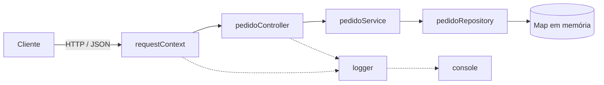

# CP5 - API de Pedidos

Arquitetura Orientada a Serviço - FIAP 3ESPY - Profa. Damiana Costa

API REST para criar e consultar pedidos de um e-commerce.

## Integrantes

| Nome | RM |
|------|----|
| Caio Rasuck Barbosa | RM93645 |
| Arthur Albuquerque | RM93025 |

## Tecnologias

- JavaScript com Node.js (versão 18 ou maior)
- Express
- Jest e Supertest para os testes
- Os pedidos ficam em um `Map` na memória, não usamos banco de dados

## Estrutura

```
cp5-pedidos/
├── docs/openapi.yaml
├── src/
│   ├── app.js
│   ├── server.js
│   ├── logger.js
│   ├── middlewares/requestContext.js
│   ├── controllers/pedidoController.js
│   ├── services/pedidoService.js
│   └── repositories/pedidoRepository.js
└── tests/pedidos.test.js
```

## 1. Arquitetura



Dividimos a API em camadas:

- **requestContext (middleware):** toda requisição passa por aqui primeiro. Ele cria um `requestId` (ou usa o que vier no header `X-Request-Id`), devolve esse id na resposta e gera um log quando a requisição chega e outro quando termina.
- **pedidoController:** é a entrada HTTP. Tem as rotas, recebe o JSON, chama o service e decide qual status devolver (201, 200, 400 ou 404).
- **pedidoService:** onde fica a regra de negócio. Valida cliente, descrição e valor (tem que ser maior que zero), gera o id do pedido e coloca o status como `CRIADO`.
- **pedidoRepository:** guarda e busca os pedidos no `Map`. Se um dia fosse usar banco de verdade, só essa parte mudaria.
- **logger:** escreve os logs no console em JSON.

Exemplo de fluxo: o cliente faz `POST /pedidos`, o middleware gera o `requestId`, o controller passa os dados pro service, o service valida e monta o pedido, o repository salva e o controller responde `201` com o pedido criado.

## 2. OpenAPI

A especificação está em [`docs/openapi.yaml`](docs/openapi.yaml). Dá pra abrir no <https://editor.swagger.io> colando o conteúdo do arquivo.

| Operação | Método | Rota | Sucesso | Erros |
|---|---|---|---|---|
| Criar pedido | POST | `/pedidos` | 201 | 400 (dados inválidos ou JSON quebrado), 500 |
| Consultar pedido | GET | `/pedidos/{id}` | 200 | 404 (pedido não existe), 500 |

Usamos `/pedidos` como a coleção. O `POST` cria um pedido novo e devolve `201` com o header `Location` apontando para `/pedidos/{id}`. O `GET /pedidos/{id}` busca um pedido específico.

## 3. Como rodar

```bash
npm install
npm start
```

A API sobe em `http://localhost:3000`. Para usar outra porta é só definir a variável `PORT`.

### Exemplos

Criar pedido:

```bash
curl -i -X POST http://localhost:3000/pedidos   -H "Content-Type: application/json"   -d '{"cliente":"Maria Silva","descricao":"Notebook Dell Inspiron 15","valor":4500.90}'
```

Resposta (201):

```json
{
  "id": "ee5be203-cd7f-470e-b77b-fb6eb163317a",
  "cliente": "Maria Silva",
  "descricao": "Notebook Dell Inspiron 15",
  "valor": 4500.9,
  "status": "CRIADO",
  "criadoEm": "2026-10-22T00:35:16.478Z"
}
```

Consultar pedido:

```bash
curl -i http://localhost:3000/pedidos/ee5be203-cd7f-470e-b77b-fb6eb163317a
```

Resposta (200): o mesmo JSON de cima.

Consultar um id que não existe:

```bash
curl -i http://localhost:3000/pedidos/nao-existe
```

Resposta (404):

```json
{
  "erro": "Pedido não encontrado",
  "requestId": "8c55fc67-5075-4226-801c-34f8e5d8b90f"
}
```

Criar pedido com dados errados:

```bash
curl -i -X POST http://localhost:3000/pedidos   -H "Content-Type: application/json"   -d '{"cliente":"","valor":-10}'
```

Resposta (400):

```json
{
  "erro": "Dados do pedido inválidos",
  "detalhes": [
    "cliente é obrigatório e deve ser texto",
    "descricao é obrigatória e deve ser texto",
    "valor é obrigatório e deve ser um número maior que zero"
  ],
  "requestId": "e57295e0-6271-4291-9ca5-e485ff785051"
}
```

## 4. Testes

Os testes estão em [`tests/pedidos.test.js`](tests/pedidos.test.js). O Supertest faz as requisições direto na aplicação, sem precisar subir o servidor. Testamos:

- criar pedido (espera 201, id gerado e status `CRIADO`)
- consultar o pedido criado (espera 200 e os mesmos dados)
- consultar um id que não existe (espera 404)
- criar pedido com dados inválidos (espera 400)

Para rodar:

```bash
npm install
npm test
```

Resultado:

```
> cp5-pedidos@1.0.0 test
> jest --verbose

PASS tests/pedidos.test.js
  API de Pedidos
    ✓ POST /pedidos cria um pedido com status CRIADO e retorna 201 (34 ms)
    ✓ GET /pedidos/:id retorna o pedido criado (10 ms)
    ✓ GET /pedidos/:id com identificador inexistente retorna 404 (3 ms)
    ✓ POST /pedidos com dados inválidos retorna 400 (4 ms)

Test Suites: 1 passed, 1 total
Tests:       4 passed, 4 total
Snapshots:   0 total
Time:        0.575 s
Ran all test suites.
```

## 5. Logs

Os logs saem no console, uma linha JSON por evento. Cada linha tem `timestamp`, `level` (`INFO`, `WARN` ou `ERROR`), `message` e o `requestId`. Quando a operação envolve um pedido, vai junto o `pedidoId`.

Logs gerados ao rodar os exemplos acima (criar, consultar e consultar um id que não existe):

```json
{"timestamp":"2026-10-22T00:35:16.456Z","level":"INFO","message":"API de pedidos iniciada","port":3000}
{"timestamp":"2026-10-22T00:35:16.471Z","level":"INFO","message":"Requisição recebida","requestId":"2b9e7cde-673a-454f-b6a0-d986683dd74e","method":"POST","path":"/pedidos"}
{"timestamp":"2026-10-22T00:35:16.478Z","level":"INFO","message":"Pedido criado","requestId":"2b9e7cde-673a-454f-b6a0-d986683dd74e","pedidoId":"ee5be203-cd7f-470e-b77b-fb6eb163317a","valor":4500.9}
{"timestamp":"2026-10-22T00:35:16.479Z","level":"INFO","message":"Requisição finalizada","requestId":"2b9e7cde-673a-454f-b6a0-d986683dd74e","method":"POST","path":"/pedidos","statusCode":201,"durationMs":8}
{"timestamp":"2026-10-22T00:35:16.510Z","level":"INFO","message":"Requisição recebida","requestId":"b25d261b-28a0-4882-9b65-1e5d66527d5e","method":"GET","path":"/pedidos/ee5be203-cd7f-470e-b77b-fb6eb163317a"}
{"timestamp":"2026-10-22T00:35:16.511Z","level":"INFO","message":"Pedido consultado","requestId":"b25d261b-28a0-4882-9b65-1e5d66527d5e","pedidoId":"ee5be203-cd7f-470e-b77b-fb6eb163317a"}
{"timestamp":"2026-10-22T00:35:16.511Z","level":"INFO","message":"Requisição finalizada","requestId":"b25d261b-28a0-4882-9b65-1e5d66527d5e","method":"GET","path":"/pedidos/ee5be203-cd7f-470e-b77b-fb6eb163317a","statusCode":200,"durationMs":1}
{"timestamp":"2026-10-22T00:35:16.517Z","level":"INFO","message":"Requisição recebida","requestId":"8c55fc67-5075-4226-801c-34f8e5d8b90f","method":"GET","path":"/pedidos/nao-existe"}
{"timestamp":"2026-10-22T00:35:16.517Z","level":"ERROR","message":"Pedido não encontrado","requestId":"8c55fc67-5075-4226-801c-34f8e5d8b90f","pedidoId":"nao-existe"}
{"timestamp":"2026-10-22T00:35:16.518Z","level":"INFO","message":"Requisição finalizada","requestId":"8c55fc67-5075-4226-801c-34f8e5d8b90f","method":"GET","path":"/pedidos/nao-existe","statusCode":404,"durationMs":1}
```

Log quando os dados enviados são inválidos:

```json
{"timestamp":"2026-10-22T00:35:10.654Z","level":"WARN","message":"Falha de validação ao criar pedido","requestId":"e57295e0-6271-4291-9ca5-e485ff785051","erros":["cliente é obrigatório e deve ser texto","descricao é obrigatória e deve ser texto","valor é obrigatório e deve ser um número maior que zero"]}
```

Pelo `requestId` dá pra juntar todas as linhas de uma mesma requisição.

Obs: quando roda `npm test` os logs não aparecem, para não poluir a saída do Jest.
